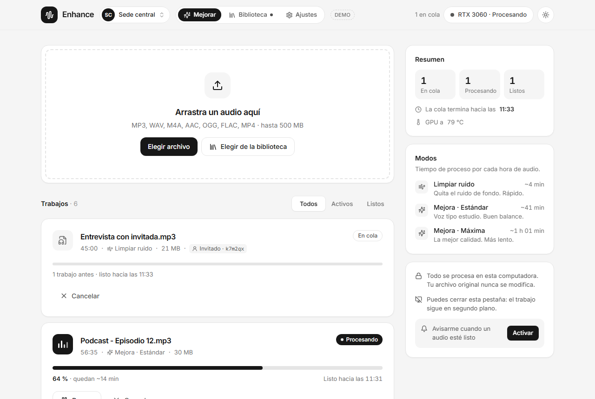
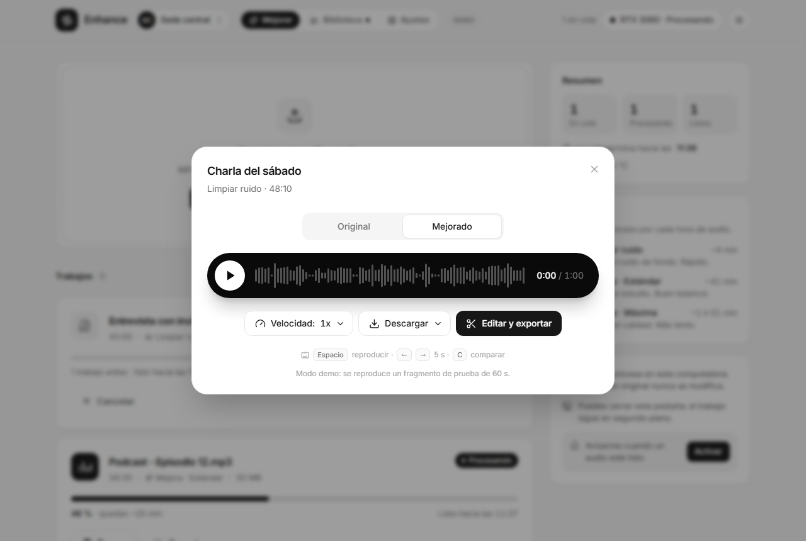
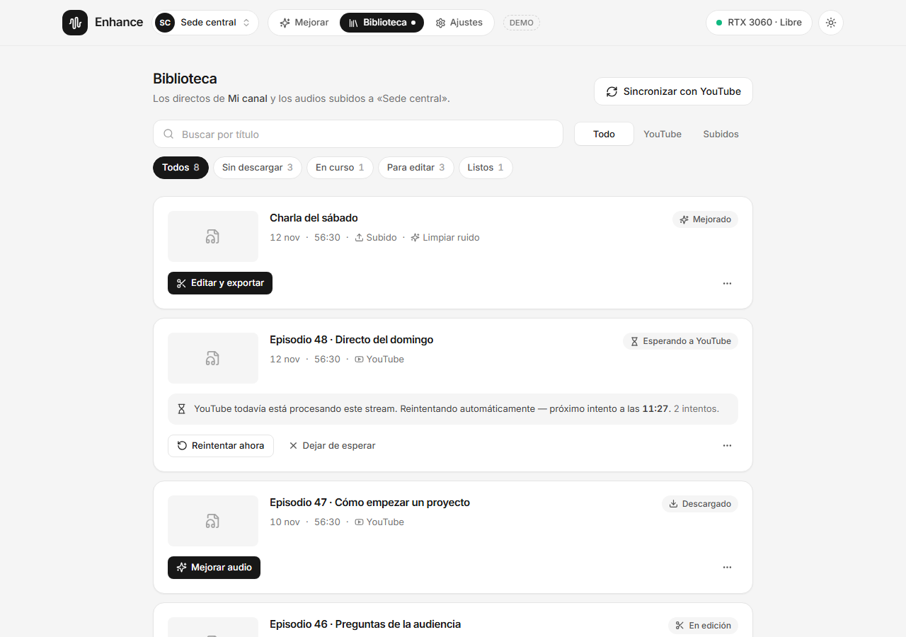
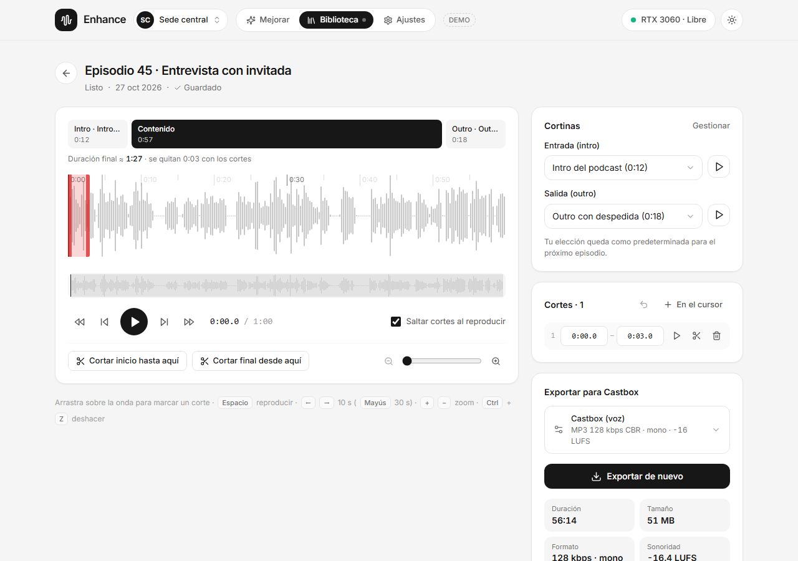
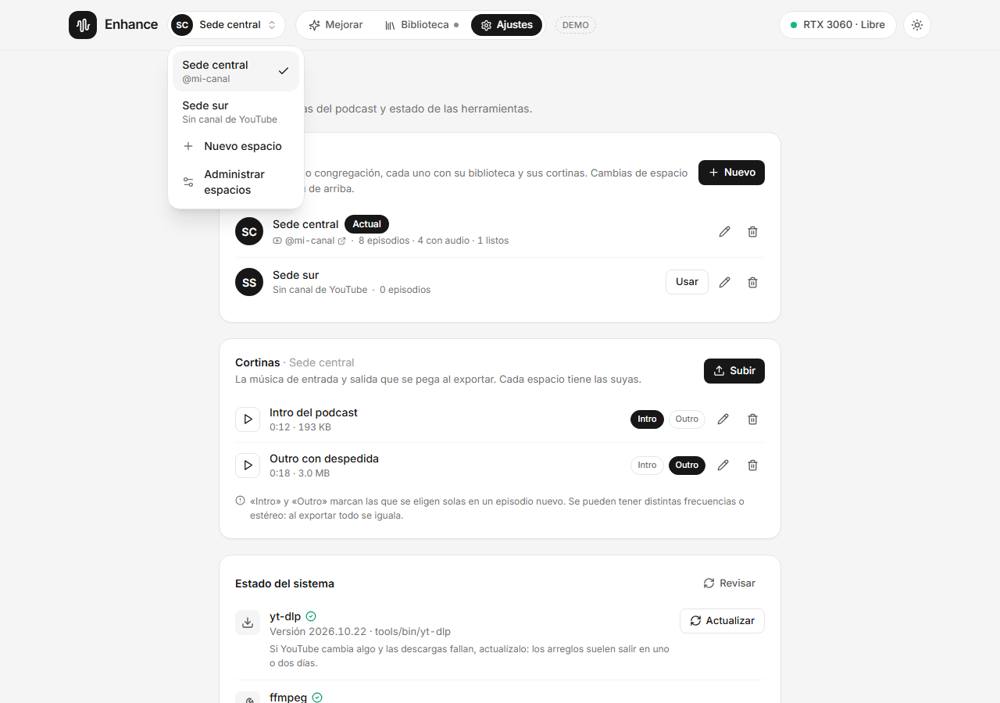

# Enhancer

**Clean up and enhance voice recordings with AI, then turn them into podcast episodes — locally, on your own NVIDIA GPU.**

Drop in an hour-long recording (a talk, a class, a podcast, a church service), pick a mode, and get back a cleaner, studio-like version. Or connect your YouTube channel: pick a past live stream, enhance it, add your intro and outro, trim what doesn't belong, and export an MP3 ready to publish. Nothing is uploaded anywhere: the audio never leaves your machine.

Powered by the open-source [Resemble Enhance](https://github.com/resemble-ai/resemble-enhance) model, with a pipeline that makes long files fit on a modest 4 GB GPU.



> The interface is in Spanish.

---

## Features

**Enhance**

- **Long files on small GPUs.** Audio is processed in small chunks, so an hour of audio fits in ~2.8 GB of VRAM.
- **Live progress.** Stage, percentage and time remaining, updated in real time.
- **Pause and resume.** Progress is saved as it goes. Closing the app mid-job, or even a crash, resumes where it left off.
- **Compare before and after.** A waveform player switches between *Original* and *Enhanced* at the same position.
- **Download** the result as MP3 or WAV.

**Library** ([details](#from-live-stream-to-podcast))

- **Every audio in one place:** the live streams from your YouTube channel (synced with yt-dlp, no API key) and your uploads, each with its status and next step.
- **One-click download** of a stream's audio track as is, with no conversion: the only lossy encoding is the final MP3.
- **Streams that just ended:** YouTube can take hours to process a live recording before it can be downloaded. The app recognizes that state, waits, and downloads it on its own when it's ready.
- **Workspaces:** one per channel or congregation, each with its own library, curtains and podcast name. Connect a channel by pasting any link to it; switch workspaces from the header.

**Editor and export**

- **Intro and outro** from your saved curtains, remembered for the next episode.
- **Cuts on the waveform:** drag to mark what doesn't belong, or type exact times; preview the result skipping the cuts. The waveform is drawn from server-side peaks, so an hour of audio never freezes the browser.
- **Podcast-ready MP3:** 128 kbps CBR mono, normalized to -16 LUFS in two passes, with ID3 tags. A summary shows the measured loudness and whether it meets your host's limits (Castbox by default).

**And also**

- **Notifications** when a job finishes.
- **Light and dark themes**, following your system or chosen from the header.
- **Optional sharing.** Let a few trusted people use your GPU through a secret link, with nothing to install on their side ([details](#share-your-local-setup)).



## Modes

| Mode | What it does | Time per hour of audio* |
|---|---|---|
| **Denoise** | Removes background noise | ~4 min |
| **Full enhancement · Standard** | Removes noise and regenerates the voice for a studio sound | ~40 min |
| **Full enhancement · Max** | Same, at the highest quality | ~1 h |

\* Measured on an entry-level 4 GB NVIDIA GPU. Faster GPUs take less, and the app recalibrates its estimates from your own finished jobs.

---

## Quick start

### Requirements

| | |
|---|---|
| **OS** | Windows 10/11 with **WSL2** (Ubuntu 22.04). Native Ubuntu should work the same. |
| **GPU** | NVIDIA with **4 GB+ VRAM**. On WSL, install the NVIDIA driver **on Windows** (not inside WSL); `nvidia-smi` should then work in Ubuntu. |
| **Python** | 3.10 with venv: `sudo apt install python3.10 python3.10-venv` |
| **ffmpeg** | `sudo apt install ffmpeg` |
| **Node.js** | 20 or newer (e.g. via [nvm](https://github.com/nvm-sh/nvm)) |
| **Disk** | ~5 GB for PyTorch and the model, plus ~1.5 GB per hour of audio being processed |
| **yt-dlp** | For the library. `npm run setup` downloads the official standalone Linux executable to `tools/bin/` (it brings its own Python; verified with SHA-256, no `sudo`). Updated from *Ajustes* |

No GPU? It still runs on CPU, just much slower.

### On macOS?

Processing audio is **not supported on macOS yet**:

- The engine relies on CUDA, which requires an NVIDIA GPU (Macs don't have one).
- The server's process tracking uses Linux's `/proc`.
- One of the model's dependencies (`deepspeed`) usually fails to install on macOS.

What you can do on a Mac:

- **Try the interface** with fake data. It only needs Node.js 20+:
  ```bash
  git clone https://github.com/jdpenav/podcast-enhancer.git
  cd podcast-enhancer/web
  npm install
  npm run dev:mock      # open http://localhost:5173/?escenario=completo
  ```
- **Use someone else's GPU.** If a friend runs Enhancer on Windows or Linux, they can [share it](#share-your-local-setup) with you. You only need a browser.
- **Run it on a Linux machine** with an NVIDIA GPU (a desktop, or a cloud GPU instance) and open it from your Mac.

### Install and run

```bash
git clone https://github.com/jdpenav/podcast-enhancer.git
cd podcast-enhancer

npm run setup   # Python venv, PyTorch, Resemble Enhance, model download (~680 MB), npm packages, yt-dlp
npm start       # builds the UI and starts the app
```

Open **http://localhost:3000**. On WSL, open it in your Windows browser.

`npm run setup` is safe to run again: it skips whatever is already installed. To only check what's missing: `bash scripts/setup.sh --check`.

To stop the app, press **Ctrl+C**. A job in progress is paused and resumes the next time you start the app.

### Commands

| Command | Use it to |
|---|---|
| `npm start` | Run the app at `localhost:3000` |
| `npm run dev` | Develop: API with auto-restart, plus the UI with hot reload at `localhost:5173` |
| `npm run setup` | Install or repair dependencies |
| `npm run share` | Run the app and share it through a secret link ([below](#share-your-local-setup)) |
| `npm --prefix web run dev:mock` | Try the UI with fake data: no GPU, Python or backend needed |

---

## From live stream to podcast

The **Biblioteca** (library) tab lists your channel's live streams next to the audio you uploaded. Each episode shows where it is and what comes next.



**1. Connect your channel (once).** In **Biblioteca**, press **Conectar canal de YouTube** and paste a link to the channel (`youtube.com/@your-channel`) or to any of its videos. The app shows the channel's name and picture so you can confirm it's the right one. Then press **Sincronizar con YouTube**: it lists every past stream in a few seconds, without downloading anything. Channels that don't stream use their *Videos* tab.

**2. Download → enhance.** **Descargar audio** saves the stream's audio track. **Mejorar audio** sends it to the GPU queue, like any upload. If the stream ended a moment ago, the episode shows *waiting for YouTube* with the time of the next automatic retry (every 30 min, for up to 12 h).

**3. Edit and export.** **Editar y exportar** opens the editor:



- Pick the intro and outro (upload them once in **Ajustes**).
- Drag on the waveform to cut silences or announcements. Use *Cortar inicio hasta aquí* / *Cortar final desde aquí* for the edges.
- **Exportar MP3.** About 2–3 minutes per hour of audio. The result shows duration, size, loudness and checks, with a player and a download button.

**4. Publish.** Upload the MP3 to your podcast host. This step is manual.

Everything (downloads, edits, exports) is stored under `data/` and survives restarts. Syncing again never duplicates episodes or touches the ones you already worked on.

### Workspaces

Producing podcasts for more than one channel, like several congregations of the same church? Create a **workspace** for each one. Every workspace has its own channel, library, curtains and podcast name (used in the MP3's tags); the GPU and its queue are shared.



- **Create one** from the header menu (*Nuevo espacio*) or in **Ajustes → Espacios**. A new workspace starts empty; *Sincronizar* brings only its own channel's streams.
- **Switch** from the header menu. The choice is remembered per browser, so two people can work on different workspaces at the same time.
- **Your data stays put:** after upgrading, everything you had becomes the first workspace (with the channel from `.env`, if you had set one). No files are moved.
- When sharing your setup, guests can switch between workspaces; only you (on `localhost`) can create, edit or delete them.

## Share your local setup

Want a friend or a teammate to use your GPU without installing anything? `npm run share` exposes the app through a [Cloudflare Tunnel](https://developers.cloudflare.com/cloudflare-one/connections/connect-networks/) on your own domain, protected by a **secret link**:

- **Guests** open the link, and from then on just the address. No account or app needed.
- **Without the link,** the site answers `404` to everyone, bots included.
- **Each guest sees only their own jobs.** You see everything from `localhost:3000`.
- **It only works while `npm run share` is running.** Close it and the link stops working.
- **You can revoke access** at any time with `npm run share:rotate`.
- **No ports are opened** on your router. It's free on Cloudflare's plan; you need a domain whose DNS is managed by Cloudflare.

Setup takes about 15 minutes, once: **[docs/sharing.md](docs/sharing.md)**.

---

## How it works

```
browser ──HTTP / live events──▶ Node.js server ──spawns──▶ Python engine ──▶ GPU
                                  │                          │
                            SQLite job queue          chunk → enhance → merge
```

1. The **web UI** (React) uploads the file (or picks it from the library) and follows progress through Server-Sent Events.
2. The **server** (Fastify) stores the job in a SQLite queue and runs **one job at a time** (a single GPU). Downloads (yt-dlp) and exports (ffmpeg) go through their own queue, in parallel.
3. The **engine** (Python) decodes the audio, enhances it in 6-second chunks, saves progress in groups, and merges the chunks back with crossfades into WAV and MP3.
4. The **editor** marks cuts and curtains in the browser (wavesurfer.js, drawn from server-side peaks); **ffmpeg** on the server cuts, joins, normalizes and encodes the final MP3.

The full flow for a podcast episode: *Biblioteca* → **Descargar audio** → **Mejorar audio** → **Editar y exportar** (intro, outro, cuts) → **Exportar MP3** → upload it to Castbox by hand.

Original files are never modified: everything happens on a copy under `data/`, and temporary files are removed when a job ends.

### Project structure

```
├── engine/       Python engine: long-audio pipeline on top of Resemble Enhance
├── server/       Node.js API: queue, live events, audio streaming      → server/README.md
├── web/          React UI (Vite + Tailwind)                            → web/README.md
├── docs/         API contract, sharing guide, screenshots
├── scripts/      setup.sh (install) and share.mjs (sharing)
├── data/         uploads, results, library, curtains, database   (created at runtime, not versioned)
├── tools/        yt-dlp                                          (downloaded by setup, not versioned)
├── venv/         Python environment                  (created by setup, not versioned)
└── modelos/      model weights                       (downloaded by setup, not versioned)
```

### Tech stack

| Part | Stack |
|---|---|
| Engine | Python 3.10, PyTorch 2.1.1 (CUDA 12.1), Resemble Enhance, ffmpeg |
| Server | Node.js 20+, Fastify 5, better-sqlite3, Server-Sent Events |
| UI | React 18, Vite 6, Tailwind CSS 3, lucide-react, wavesurfer.js 7 |
| Library | yt-dlp (channel listing and downloads), the channel's public RSS feed |
| Sharing (optional) | Cloudflare Tunnel |

---

## Configuration

Everything works out of the box. To change something, copy `.env.example` to `.env` (not versioned) and uncomment what you need, or set the variables in your environment:

| Variable | Default | Description |
|---|---|---|
| `PORT` | `3000` | App port |
| `COOLDOWN_SEC` | `0` | Pause between chunk groups so the GPU can cool down (e.g. `5`) |
| `MAX_UPLOAD_MB` | `500` | Maximum upload size |
| `DATA_DIR` | `./data` | Where uploads, results and the database are stored |
| `HOST` | `localhost` | Network interface. Keep it local: anyone who can reach it can use your GPU |
| `YT_CHANNEL_ID` / `YT_STREAMS_URL` / `PODCAST_NAME` | | Only to upgrade an older install: the first workspace is created with them. Channels are now connected from the app |
| `RSS_SYNC_HOURS` | `3` | How often to check the RSS feed for new streams (it only lists them, never downloads). `0` turns it off |
| `VOD_RETRY_MIN` / `VOD_RETRY_MAX_HOURS` | `30` / `12` | Retries for a stream that YouTube is still processing |
| `YTDLP` / `YTDLP_EXTRA_ARGS` | | Another yt-dlp binary / extra arguments (e.g. `--cookies file.txt`) |

## Good to know

- **VRAM:** the engine uses 6-second chunks. On 4 GB cards, 8 s or more overflows memory and runs several times slower.
- **Heat:** long jobs can push a laptop GPU above 85 °C. A cooling pad or `COOLDOWN_SEC` helps.
- **One job at a time:** jobs queue up. If an engine started by hand is already using the GPU, the queue waits for it.
- **Engine without the UI:**
  ```bash
  source venv/bin/activate
  python engine/enhance_long.py input.mp3 output.mp3 --mode denoise
  python engine/enhance_long.py input.mp3 output.wav --mode enhance --nfe 32 --also-mp3 output.mp3
  ```
  Ctrl+C pauses; running the same command again resumes.

## Credits

- [Resemble Enhance](https://github.com/resemble-ai/resemble-enhance) by Resemble AI: the speech enhancement model doing the heavy lifting.
- [ffmpeg](https://ffmpeg.org/) for decoding and encoding.
